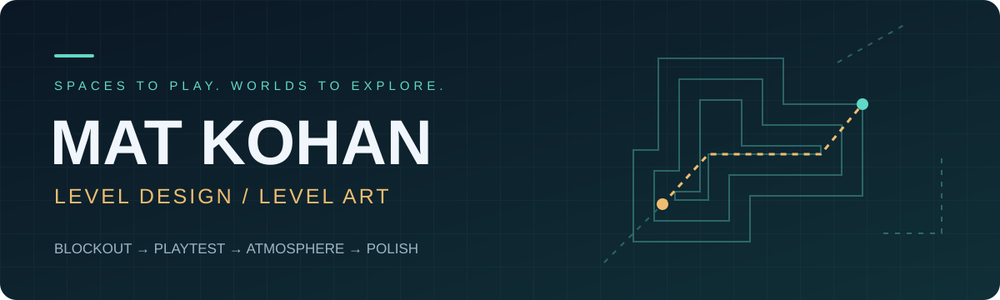

  

<h3 align="center">👋 Hi, I’m Mat — I turn spaces into playable experiences.</h3>

From the first blockout to the final atmosphere. Level Designer &amp; Level Artist working in Unreal Engine and Unity.

  
  

<a href="#-what-i-create">What I create</a> &nbsp; / &nbsp; <a href="#-toolbox">Toolbox</a> &nbsp; / &nbsp; <a href="#-selected-work">Selected work</a> &nbsp; / &nbsp; <a href="#-lets-build-something">Collaboration</a>

---

## 🧭 What I create

I build spaces that feel good to play and have a strong sense of place, taking levels from early blockouts through gameplay iteration and visual polish.

<table>
<tr>
<td width="50%" valign="top">
<h3>01 / Level Design</h3>

<b>Make every route matter.</b>

Layouts, greyboxing, combat spaces, exploration routes, and environmental puzzles. Player flow, pacing, scale, and readability guide each iteration.

</td>
<td width="50%" valign="top">
<h3>02 / Level Art</h3>

<b>Give every space a sense of place.</b>

Environment dressing, modular assets, materials, lighting, and composition. Visual identity and atmosphere that stay connected to gameplay.

</td>
</tr>
</table>

<b>BLOCKOUT</b> &nbsp; → &nbsp; <b>PLAYTEST</b> &nbsp; → &nbsp; <b>ITERATE</b> &nbsp; → &nbsp; <b>POLISH</b>

## 🛠 Toolbox

**Prototype → implement → refine.** I test ideas in-engine and script interactions and events with Unreal Engine Blueprints and C#.

## 🎮 Selected work

<table>
<tr><td width="50%" align="center"><a href="https://www.artstation.com/artwork/rzzeEm"> <b>Samla TDM Map ↗</b></a></td><td width="50%" align="center"><a href="https://www.artstation.com/artwork/K3qogr"> <b>Triton Platform ↗</b></a></td></tr>
<tr><td width="50%" align="center"><a href="https://www.artstation.com/artwork/V88kBX"> <b>POI 02 Samla ↗</b></a></td><td width="50%" align="center"><a href="https://www.artstation.com/artwork/kQ39Jl"> <b>Sisu House ↗</b></a></td></tr>
</table>

<a href="https://www.artstation.com/mkohan"><b>Explore the full portfolio on ArtStation →</b></a>

---

## 🤝 Let’s build something

**Available for freelance and cool projects.** Have an idea for a space, a world, or a playable prototype? [Let’s connect on LinkedIn](https://www.linkedin.com/in/m-kohan/).

Thoughtful layouts. Readable spaces. Memorable worlds.

